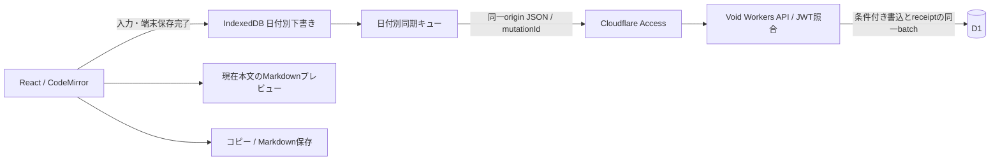

# 詳細設計・判断記録

確定要件は[requirements.md](requirements.md)。ここは実装の契約と判断理由を記録する。APIの正確なTypeScript定義は`src/lib/types.ts`、SQLは`db/migrations/`を正とする。

## 構成

起動時は認証確認後に一覧を出す。UIとAPIの全パスをAccessで保護し、WorkerもJWTの署名・issuer・audience・expiry・本人emailを検証する。ローカル開発専用の認証例外はlocalhostに限定し、公開ホストの未設定認証をfail closedにする。

対象日付はTokyoのcivil date。`YYYY-MM-DD`をURL/DBへ使い、本文をURLへ入れない。日時はUTC ISO文字列。編集中の対象日付は固定し、今日ボタンだけその時点のTokyo日を計算する。

## ADR 01: 日付の一意性と操作を分ける

`diaries`: `id TEXT PK`、`diary_date TEXT UNIQUE NOT NULL`、`body TEXT NOT NULL`、`version INTEGER >=1`、nullable `deleted_at`、UTC文字列`created_at/updated_at`。本文はDBでもUTF-8バイト数上限をCHECKする。通常一覧用に削除状態/日付のindex。

日付が無い時はcreate、存在する時はupdateを明示する。createはid/expectedVersionがnullで、空日かつ非空本文、さらにGETで取得した`absenceToken`（nullまたはその日の最後のmutationId）が一致する場合だけ成功する。updateはid/expectedVersionが一致する既存の有効日記にだけ適用する。既存の空本文は許可する。ゴミ箱に同日があれば409として復元を案内する。

trash/restoreはversionを1進める。purgeはゴミ箱の日記だけ、確認UIを経由し、id/version一致時だけ物理削除する。purge後のupdateはcreateへ変換しない。利用者が空の日を改めて確認した後の明示createだけ、新IDで作成できる。空日を開いた端末Aが未送信createを持ち、端末Bが同日を作成して完全削除した場合も、Aの古いabsenceTokenを拒否する。現在「無い」という状態だけを見て再作成しない。日付ごとのreceipt検索用indexを持ち、新しいtombstoneテーブルは作らない。

## ADR 02: operation receiptを本文なしで無期限保持

`mutation_receipts`: mutation_id PK、request_hash（SHA-256）、diary_id/date、kind、result_version、epoch、created_at。本文を複製しない。MVPでは削除期限を置かず永久保持する。これにより長期間offlineの端末から古い成功済みcreateが届いても、purge後に勝手に再作成されない。receiptの容量増加は運用で確認する。

書込契約は `{ mutationId, kind, id, expectedVersion, body?, epoch, absenceToken? }`。対象日はURL、kindはcreate/update/trash/restore/purge。createだけabsenceTokenを必須とし、他kindには送らない。クライアントは**送信前にこのリクエスト全体をIndexedDBへ固定**する。応答が不明な場合は内容もmutationIdも変えずに再送する。変更された次本文には、前操作を確認した後で新しいmutationIdを発行する。

サーバーは日付・kind・id・expectedVersion・body・epoch等を固定順でハッシュ化する。同ID同hashは以前の適用結果として応答し再適用しない。同ID異hashは409 MUTATION_ID_REUSED。成功receiptがない時だけ、条件付きreceipt INSERTと実データ書込を**D1の同一batch transaction**で処理する。receipt挿入のchanges()により後続実書込をgateし、二重適用やreceiptだけ残る状態を防ぐ。条件不一致なら409で最新日記を返す。

レスポンスは `{ diary, epoch, mutationId, appliedVersion, appliedDiaryId, absenceToken, replayed }`。`diary`は現在のサーバー状態で、receiptが示す適用版より新しい場合もある。クライアントはappliedDiaryId/appliedVersionと現在diaryを照合し、別更新があれば本人確認へ進む。古receiptの成功を見て現在本文まで保存済みと誤認しない。

更新前提照合はprimaryで行う。Voidがread replicaを用意しても、書込の条件判断へ遅延したreplicaを使わない。条件とreceiptをbatch内でも再確認する。[Void D1/read replication](https://void.cloud/guide/database/d1)

## ADR 03: DB復旧をversionと別のepochで検出

`app_meta(key TEXT PK, value TEXT)`の`database_epoch`にDB世代IDを持つ。通常のアプリ更新では変更しない。全書込がepochを送信する。SQL復元/Time Travel後は書込再開前に**新UUIDへ回転**する。

versionだけでは巻き戻し後に古端末の期待値と偶然再一致する。epoch不一致なら409 EPOCH_CHANGEDで同期停止し、端末版と復旧後サーバー版を保持して本人が確認する。復元スクリプトは全表の一致を確認してからepochだけ回転し、receiptの元epochは履歴として残す。epochを回転しない手動Time Travelは運用違反となるため[復旧手順](operations.md)で必須にする。

## ADR 04: 端末保存と同期の状態を別に持つ

IndexedDBは日付をキーとして本文、最後のサーバー版、epoch、ローカルrevision、dirty、固定したpending操作、未同期開始日時、problem、再試行予定を保持する。認証tokenは保存しない。read→change→writeを単一transactionにし、transaction完了後だけ端末保存成功を返す。revision照合で古いタブによる端末本文の上書きを防ぐ。

入力は直ちに端末保存し、D1は初期値1秒のdebounce。日付移動はその日付の端末保存完了を待つ。サーバー応答は日付・mutationId・送信revisionに対応させ、他の日付や後続本文へ誤反映しない。pendingの送信中も次本文を保持する。1日に同時送信する操作は1件。別タブでは短いleaseとBroadcastChannelで補助し、最終的な正当性はDBのversion/receiptに委ねる。

保存状態はlocal-saving/local/syncing/unsynced/auth/conflict/error/savedをUIへ翻訳する。端末保存失敗時は画面の本文を保持し、警告＋退避手段を表示して無警告の日付移動を止める。未同期を日数で消さない。24時間以上の未同期は手動退避を案内する。

通信/一時5xxは待機を延長してretryし、Retry-After秒数/HTTP日付を尊重する。online・focus・再表示・手動も再試行契機。認証/競合/入力不正/サイズ超過は自動再送停止。再認証は下書きを残し、最新サーバー版・epochを読み直してから再開する。バックグラウンド終了後の送信継続、offline初回起動、全過去日記cacheはMVPの保証外。

## ADR 05: 競合は両本文を保持して再検証

409で該当日の自動同期だけ止め、端末本文とサーバー本文・削除状態・epochを保持する。Androidは縦に並べる。サーバー採用・端末採用・手動統合の結果を確認してから保存する。解決直前に最新状態を読み、期待id/version/epochを作り直す。再度変わっていたら再び409とし、確認前の状態で上書きしない。

trash/restore/purgeも同じ前提照合を使う。ゴミ箱と有効本文、完全削除と端末下書きの衝突を単なる空本文として処理しない。コピー/Markdown出力はネットワークや同期成功を必要とせず、現在端末本文から作る。

## ADR 06: Markdownはソースを唯一の本文とする

CodeMirrorは固定文字サイズの軽い構文ハイライト。編集インスタンスを維持してpreview切替時のselection/scrollを保つ。IME composition中のtoolbar操作は未確定入力を破壊しないように扱う。AndroidのvisualViewport/soft keyboard動作は実機確認が必要。

previewはreact-markdown＋remark-gfmで現在本文を描画し、生HTMLを実行しない。外部画像をimgへ変換せずリンクにする。危険schemeを拒否する。チェックボックスはASTのソース位置を使い、同文が複数でも該当する`[ ]`/`[x]`だけ変える。プレビューから本文を作り直さない。

## HTTP・公開境界

| Method / path                      | 契約                                                                                                                                                                                                                                               |
| ---------------------------------- | -------------------------------------------------------------------------------------------------------------------------------------------------------------------------------------------------------------------------------------------------- |
| GET `/api/session`                 | 認証確認。本人以外へ本文を返さない。                                                                                                                                                                                                               |
| GET `/api/diaries`                 | 通常/ゴミ箱一覧。`before`日付cursor、`limit`初期20（1〜100）。本文を含まないsummary。                                                                                                                                                              |
| GET `/api/diaries/:date`           | `{diary, epoch, absenceToken}`。未作成はnull、ゴミ箱も状態付きで返す。absenceTokenはその日のreceiptに基づく不在世代の照合値。                                                                                                                      |
| POST `/api/diaries/:date`          | 明示kindによる条件付き書込。create/update/trash/restore/purge。                                                                                                                                                                                    |
| GET `/api/diaries/:date/neighbors` | D1の有効日記の前後日。端末だけの未同期日はclient側で統合。                                                                                                                                                                                         |
| GET `/api/export`                  | `{formatVersion:2, exportedAt, epoch, snapshotToken, diaries, nextCursor}`。各日記に現在要約`aiSummary`（なければnull）。3件/page。継続は`after=nextCursor&snapshotToken=最初のtoken`。設定画面で1つのJSONへまとめ、内部token/cursorは出力しない。 |

JSON error: `{ code, message, diary?, epoch?, absenceToken? }`。400は入力/日付/件数不正、401は認証要求、403は本人/CSRF拒否、409は競合/epoch変更/ID再利用/export途中変更、413は本文上限、415はContent-Type不正、503は一時障害/設定やDB準備不足。本文エラーをログへ埋めず短い一般文へ変える。

JSON出力のsnapshotTokenはepochと本文・要約それぞれのreceiptの最大rowidから作り、pageと同じbatchで取得する。途中で書込があれば409 EXPORT_CHANGEDで全出力をやり直す。Freeの1invocation50 queries・Worker RAM制約があるため、全行をWorkerへ集めたり1レスポンス内で日数分queryを続けたりしない。ブラウザはpageを順次取得して1つのdownloadにするため、非常に大量の全件出力には端末側のメモリ制約が残る。

書込はsame-origin＋JSON契約を検証する。本文API/JSON/downloadはno-store。UIのlogout後は本文を隠し、未同期残存に注意し、端末下書き自体は無断削除しない。Access設定、代替公開URL、期限切れをローカルunitだけで証明できないため公開前の実証項目に残す。

## ADR 07: 本文と独立したMCP・要約

`POST /mcp`はstateless Streamable HTTPのJSON応答。2025-03-26 / 2025-06-18 / 2025-11-25のinitialize・ping・tools/list・tools/call・通知を扱う。SSEストリーム・サーバー要求・MCPセッションは作らず、GET/DELETEは405。ブラウザAPIのCSRF例外は厳密に`/mcp`だけ。

本番は`MCP_ORIGIN`のHTTPS origin/Host、Origin（存在時は自originまたはhttps://chatgpt.com）を検証する。Managed OAuthはBearerを消費して`Cf-Access-Jwt-Assertion`を転送するため、生のBearerがWorkerへ残ることを前提にしない。`ACCESS_TEAM_DOMAIN`と`MCP_ACCESS_AUD`で署名・issuer・audience・iat/exp・`ACCESS_EMAIL`を既存関数で照合する。`Sec-Fetch-Site`を持つブラウザ送信は拒否する。設定不足は503、匿名・偽造・別人・期限切れを拒否する。loopbackの開発例外だけ維持する。

一覧は最大366日・20件、検索は31日・10件・検索語100 UTF-8 bytesのリテラル部分一致。原文はD1でBLOBとして12000bytesずつ切り出し、WorkerでUTF-8境界へ戻す。NUL・絵文字・CRLFも保持する。HMACで署名したcursorに日記ID・日付・version・epoch・要約revision・次offsetを固定し、改変・途中変更を拒否する。最後の分割だけsourceTokenを返す。完全取得前の要約保存にこのトークンは発行しない。本文・抜粋・URLは非信頼データとツール説明と応答に明記する。

`list_pending_summaries`はTokyoの当日未満を古い順に最大3件返す。現在要約のsource versionまたはepochが違えばstaleとして再処理する。空日は作らない。空本文の既存日記は対象になる。ゴミ箱は全MCP取得から除外する。

`diary_summaries`はdiary IDを主キーに現在要約、source version/epoch、独立revision、更新時刻を持つ。`summary_history`はID/revisionを複合主キーとする。両表の外部キーON DELETE CASCADEにより、完全削除時に本文と同じtransactionで消える。trash/restoreは要約を保持し、本文versionの変更で古くなる。`summary_mutation_receipts`は操作ID、固定payloadのSHA-256、ID/version、適用revision、epoch、時刻だけを無期限保持する。

save_summaryはID・日付・source version・epoch・expectedRevision・最終sourceTokenを照合する。条件付きreceipt INSERT→changes()でgateした現在要約upsert→履歴INSERTを同じD1 batchで実行する。照合はfirst-primary sessionとbatch内で行う。同一ID同内容は元の適用revisionを返し、現在要約を上書きしない。同ID異内容・古い版・削除・同日別ID・復旧後epochは拒否する。既存の本文receipt/absenceTokenの契約には変更を加えない。

`mcp_daily_usage`はTokyo日付単位で全isolate共通の500 tool calls・20検索・原文予約2,000,000bytesを上限にする。`read_characters`列には実際には予約UTF-8バイト数を保存する。原文取得1回につき12000bytesを先に予約し、失敗も加算する。条件付きUPDATEで並行呼出も制限する。前日までのカウンターは次の利用時に削除する。本文・検索語・認証情報は記録しない。1応答100000bytes・1リクエスト32000bytes。通常の日記保存にはこの予算を適用しない。

JSON形式版2は各日記の`aiSummary: {summary, sourceVersion, sourceEpoch, revision, updatedAt} | null`を出力する。ゴミ箱と古い要約もそのまま含む。履歴・receipt・取得予算の完全退避はSQLを使う。SQL復元では親表→子表の順に挿入し、外部キーを無効化せず検証する。復旧後のepoch回転により、すべての古い要約が次回の未処理対象になる。

## バックアップの制約（追加機能後）

SQLバックアップはDB全体（receipt/epochを含む）を対象にし、JSON出力とは用途が異なる。本文約1MBが単一INSERTになるとD1 SQL文上限100KBを超えるため、空SQLiteへSQLを復元した後、空D1へ小さいparameterized SQLで転送する経路を用意した。ローカル実証と実Cloudflare実証を別々に記録する。実行手順・保管3世代・暗号化・復旧判断は[operations.md](operations.md)。
