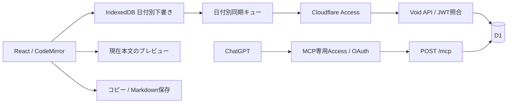

# 詳細設計・判断記録

機能の範囲は [要件](requirements.md)、通信型は `src/lib/types.ts`、DBスキーマは `db/schema.ts`、適用SQLは `db/migrations/` を参照する。

## 構成

認証確認後に一覧を表示する。画面・APIはAccessで保護し、WorkerもJWTの署名・issuer・audience・有効期限・本人emailを検証する。認証省略は開発モードのloopbackだけで、公開設定が不足した場合は拒否する。

記録日はAsia/Tokyoの `YYYY-MM-DD`、作成・更新時刻はUTC ISO文字列。本文をURLへ入れない。編集中の対象日は固定し、「今日」を選んだ時だけ再計算する。

## 日記の作成・更新・削除

`diaries` はidを主キー、diary_dateを一意とし、body・version（1以上）・deleted_at・created_at・updated_atを持つ。本文のUTF-8バイト上限はDBのCHECKでも検証する。

| kind            | 成功条件・動作                                                         |
| --------------- | ---------------------------------------------------------------------- |
| create          | id/expectedVersionがnull、空日、非空本文、GETで得たabsenceTokenが一致  |
| update          | 有効な既存日記のid/expectedVersionが一致。保存済み本文は空文字にできる |
| trash / restore | id/versionを照合し、versionを1進める                                   |
| purge           | ゴミ箱のid/versionと明示確認を照合し、物理削除する                     |

同日がゴミ箱なら409で復元を案内する。purge後のupdateをcreateに変換しない。空日を改めて確認した後のcreateだけ、新IDで作成できる。

`absenceToken` はnullまたはその日の最後のmutationId。空日を見た端末Aの未送信createは、端末Bが同日を作成・完全削除した後には拒否する。日付ごとのreceipt indexで照合し、現在「無い」ことだけを作成条件にしない。

## 再送と操作履歴

`mutation_receipts` はmutation_id、request_hash（SHA-256）、diary_id/date、kind、result_version、epoch、created_atを保存する。本文は複製せず、削除期限を設けない。古い成功済みcreateの再送による、完全削除後の再作成を防ぐ。

書込要求は `{ mutationId, kind, id, expectedVersion, body?, epoch, absenceToken? }`。対象日はURLで指定し、absenceTokenはcreateだけに必須で、他kindには送らない。クライアントは送信前に要求全体をIndexedDBへ固定し、応答不明ならIDも内容も変えずに再送する。次の本文には前操作の確認後、新しいIDを発行する。

サーバーは固定順の要求をハッシュ化する。同ID・同hashは以前の結果を返し、同ID・異hashは409 `MUTATION_ID_REUSED`。未適用なら条件付きreceipt INSERTと本文変更を同じD1 batchで実行する。INSERTの `changes()` を後続書込の条件にし、前提不一致なら409で最新状態を返す。

応答は `{ diary, epoch, mutationId, appliedVersion, appliedDiaryId, absenceToken, replayed }`。diaryは現在の状態で、操作適用時より新しい場合もある。クライアントは適用ID/versionと現在diaryを照合し、古い成功receiptだけで最新本文を「保存済み」にしない。

更新前提は `server/database.ts` のprimary優先セッションで照合し、batch内でも再確認する。遅延したread replicaを条件判断に使わない。

## DB復旧とepoch

`app_meta.database_epoch` は通常更新では変えず、全書込に送信する。versionだけでは巻戻し後に古い端末の期待値と偶然再一致するため、SQL復元・Time Travel後は書込再開前に新UUIDへ回転する。

epoch不一致は409 `EPOCH_CHANGED` とし、端末版と復旧後のサーバー版を保持して同期を止める。本人が比較し、必要な変更を再適用する。復元スクリプトは全表一致を確認してからepochを回転し、receipt内の元epochは履歴として残す。実行手順は [運用](operations.md#障害復旧) を参照する。

## 端末保存と同期

IndexedDBは日付別に本文、最後のサーバー版、epoch、ローカルrevision、dirty、固定pending操作、未同期開始時刻、problem、再試行予定を持つ。認証tokenは保存しない。読取・変更・書込を単一transactionで行い、完了後にだけ端末保存成功とする。revisionで古いタブからの上書きを防ぐ。

入力は直ちに端末保存し、D1同期は初期値1秒のdebounce。日付移動は端末保存の完了を待つ。サーバー応答は日付・mutationId・送信revisionへ対応させ、別日や後続本文へ反映しない。pending送信中も次本文を保持し、1日に同時送信する操作は1件とする。タブ間はleaseとBroadcastChannelで補助し、最終判定はDBのversion/receiptで行う。

状態はlocal-saving/local/syncing/unsynced/auth/conflict/error/saved。端末保存失敗時は画面の本文と退避手段を残し、無警告の日付移動を止める。未同期を日数で削除せず、24時間以上なら手動退避を案内する。

通信障害・一時5xxは待機を延長し、Retry-Afterの秒数/HTTP日付を尊重する。online・focus・再表示・手動でも再試行する。認証・競合・入力不正・サイズ超過は自動再送を止める。再認証後は最新version/epochを読み直す。終了後の同期継続、オフライン初回起動、全過去日記のcacheは保証しない。

## 競合と本文の退避

409ではその日の自動同期を止め、両本文・削除状態・epochを保持する。Androidでは縦に並べ、サーバー採用・端末採用・手動統合を本人が確認する。解決直前に最新id/version/epochを読み、再変更があれば再び409とする。

trash/restore/purgeも同じ照合を使い、ゴミ箱・完全削除を空本文として処理しない。コピーとMarkdown保存は通信や同期の成功に依存せず、現在の端末本文から作る。表示は [エラーと復旧導線](error-recovery.md) を参照する。

## Markdown

CodeMirrorは文字サイズ固定の構文色分けを使う。プレビュー切替時も編集インスタンスを維持し、選択・スクロールを保つ。IME composition中の補助バーは未確定入力を保護する。

react-markdown + remark-gfm + remark-breaksで現在本文を表示する。生HTMLは実行せず、外部画像はリンク化し、危険schemeを拒否する。チェック項目はASTのソース位置から該当する `[ ]` / `[x]` だけを変える。プレビューから本文を再生成しない。

## HTTP API

| Method / path                      | 内容                                                               |
| ---------------------------------- | ------------------------------------------------------------------ |
| GET `/api/session`                 | 認証確認                                                           |
| GET `/api/diaries`                 | 通常/ゴミ箱一覧。before日付cursor、limit初期20（1〜100）。本文なし |
| GET `/api/diaries/:date`           | `{diary, epoch, absenceToken}`。未作成はnull、ゴミ箱は状態付き     |
| POST `/api/diaries/:date`          | kindを明示した条件付き書込                                         |
| GET `/api/diaries/:date/neighbors` | 有効日記の前後日。端末だけの未同期日はクライアントで統合           |
| GET `/api/export`                  | JSON形式版2。現在要約aiSummaryを含め、3件ずつ取得                  |

出力応答は `{formatVersion:2, exportedAt, epoch, snapshotToken, diaries, nextCursor}`。継続は `after=nextCursor&snapshotToken=最初のtoken`。ブラウザで1つのJSONにまとめ、内部token/cursorはファイルに含めない。

snapshotTokenはepochと本文・要約receiptの最大rowidから作り、pageと同じbatchで取得する。途中変更は409 `EXPORT_CHANGED` として全出力をやり直す。Workerへ全行を集めない。大量出力にはブラウザ側のメモリ制約が残る。

エラーは `{ code, message, diary?, epoch?, absenceToken? }`。400は入力不正、401は認証要求、403は本人/CSRF拒否、409は競合・epoch変更・ID再利用・出力途中変更、413は本文上限、415はContent-Type不正、503は一時障害・設定/DB準備不足。本文や生の例外をログへ入れない。

ブラウザの書込はsame-origin + JSONを検証する。本文API・出力はno-store。ログアウト後は本文を隠すが、未同期下書きを無断削除しない。

## MCPと要約

`POST /mcp` はstateless Streamable HTTPのJSON応答。2025-03-26 / 2025-06-18 / 2025-11-25のinitialize・ping・tools/list・tools/call・通知に対応し、GET/DELETEは405。SSE・サーバー要求・MCPセッションは作らない。CSRF例外は厳密にこのパスだけとする。

MCP_ORIGINのHTTPS origin/Hostを検証する。Originがあれば自originか `https://chatgpt.com` だけを許可し、Sec-Fetch-Site付きのブラウザ送信は拒否する。Managed OAuthがBearerを消費した後の `Cf-Access-Jwt-Assertion` を、MCP_ACCESS_AUDと既存の本人認証設定で照合し、署名・issuer・audience・iat/exp・本人emailを検証する。設定不足は503、匿名・偽造・別人・期限切れは拒否する。

| ツール                 | 上限・動作                                                                  |
| ---------------------- | --------------------------------------------------------------------------- |
| list_diaries           | 最大366日・20件                                                             |
| search_diaries         | 最大31日・10件、検索語100 UTF-8 bytes。リテラル部分一致                     |
| get_diary              | 原文を12,000bytesずつBLOBで取得し、UTF-8境界へ戻す。NUL・絵文字・CRLFを保持 |
| list_pending_summaries | Tokyoの当日未満を古い順に最大3件。未要約とsource version/epoch不一致を対象  |
| save_summary           | 全文取得後、元日記と要約の更新前提を照合して要約だけ保存                    |

ゴミ箱は全取得から除外する。空日は作らず、既存の空本文は要約対象になる。本文・抜粋・URLは非信頼データとしてツール説明と応答に明示する。

HMAC署名cursorは日記ID・日付・version・epoch・要約revision・次offsetを固定し、改変や途中変更を拒否する。最後の分割だけsourceTokenを返し、全文取得前には発行しない。

`diary_summaries` はdiary IDを主キーに現在要約・source version/epoch・独立revision・更新時刻を持つ。`summary_history` の主キーはID/revision。両表は外部キーON DELETE CASCADEで本文の完全削除時に同じtransactionで消える。trash/restoreでは保持し、本文version変更により古い要約になる。

`summary_mutation_receipts` は操作ID・固定payloadのSHA-256・ID/version・適用revision・epoch・時刻だけを無期限保持する。save_summaryはID・日付・source version・epoch・expectedRevision・最終sourceTokenをprimary優先とbatch内で照合し、条件付きreceipt INSERT→changes()を条件にした現在要約upsert→履歴INSERTを同じbatchで行う。同ID同内容は元の適用revisionを返し、現在要約を上書きしない。異内容・古い状態・削除・同日別ID・復旧後epochは拒否する。

`mcp_daily_usage` で全isolate共通の日次上限を管理する。Tokyo日付で500 tool calls・20検索・原文予約2,000,000bytes。`read_characters` 列は予約UTF-8バイト数で、get_diaryごとに12,000bytesを先に予約し、失敗も加算する。条件付きUPDATEで並行呼出を制限し、前日以前のカウンターは次の利用時に削除する。本文・検索語・認証情報は記録しない。1応答100,000bytes、1要求32,000bytes。通常の日記保存にはこの予算を適用しない。

JSONの `aiSummary` は `{summary, sourceVersion, sourceEpoch, revision, updatedAt} | null`。ゴミ箱と古い要約も出力する。履歴・receipt・予算を含む完全退避はSQLを使う。親表から子表へ復元して外部キーを検証し、epoch回転後は旧要約を未処理へ戻す。1MB本文の分割復元と保管方法は [運用手順](operations.md) にまとめる。
