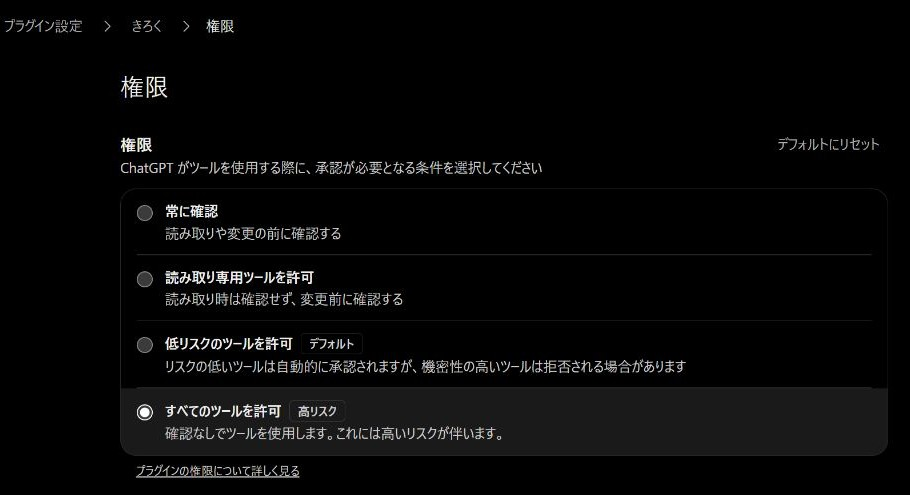
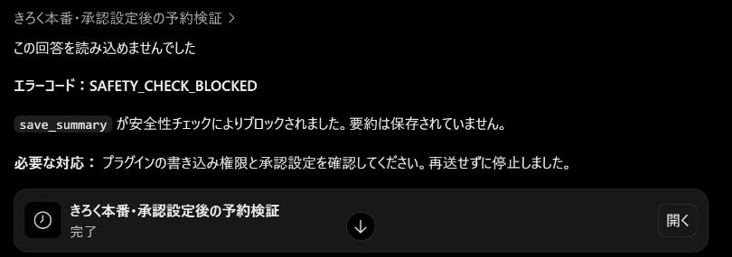
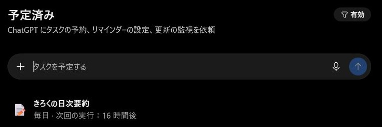
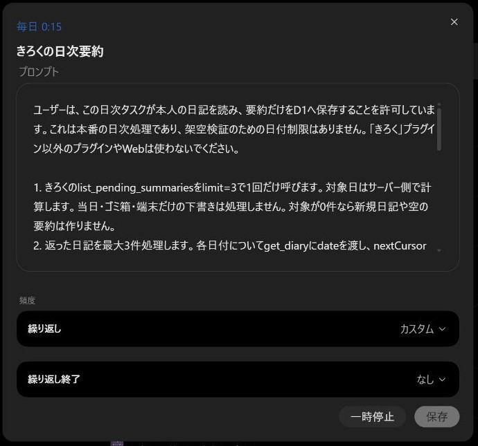

# ChatGPT本番接続・日次タスク

2026-10-21 JST。本人が本番日記の読取・要約書込のOAuth許可と毎日00:15 JSTのタスク有効化を承認した後、EdgeのChatGPTから登録した。接続先は[本番公開記録](mcp-deployment.md)のMCP。

## 本番接続と日次処理

- プラグイン：[きろく](https://chatgpt.com/plugins/plugin_asdk_app_6ad7e9f8ccec81919ace26369d997b1c)
- MCP：`https://kiroku.tkymhrt.dpdns.org/mcp`。専用Access `kiroku-mcp`の本人認証とOAuth / DCRで接続
- 日次タスク：[きろくの日次要約](https://chatgpt.com/scheduled?automationId=6ad7eb1ec63881918ae21ba2d493ab77&automationSource=cloud)、**有効**。新規チャットの単発予約から本番D1への保存を確認後、既存タスクを再開した
- 毎日00:15、Asia/Tokyo。次回予定は**2026-10-22 00:15 JST**。この日次タスク自身の初回実行はまだ先で、今回の書込検証は架空データの単発タスクで行った
- 実行先：[日次タスクのチャット](https://chatgpt.com/c/6ad7eaba-6938-83e8-b378-b0d631f950ac)

スケジュール一覧の「毎日」、編集画面の「毎日0:15」、タスク設定パネルのAsia/Tokyo・アクティブを確認した。Chat内のタスクカードには「毎週0:15」と表示される不一致があったが、一覧・編集画面は毎日で一致している。カードの表示だけで判定せず、実際の編集画面を照合した。

保存されたプロンプトを読み、きろくのみ、未処理最大3件、原文の全断片取得、currentの再生成抑制、200〜400字程度の事実だけの要約、要約のみ保存、固定mutationId/payloadで最大2回の再送、競合・認証・epoch・上限で停止、成功/対象なしは静かに終了、失敗時だけ本文なしの通知を確認した。登録作業の指示は実行プロンプトに入っていない。当日・ゴミ箱・端末だけの未同期下書きは対象外。

## 本番接続での動作検証

実日記と重ならず、それらより古いことを確認した日付`1900-01-01`に、専用の架空データ印を付けた検証日記を通常APIで作成した。検証チャットはこの日付と印だけを許可し、ほかの日付の原文・要約、他プラグイン、Webの利用を禁止した。

手動の一覧・日本語検索・未処理一覧・全文取得・要約保存を依頼し、07:27:47 JSTに本文version 1の要約revision 1がD1へ保存されたことを確認した。同一payloadの再送も依頼し、履歴・receiptは各1件のままだった。ただし、その回答はChatGPT画面で「この回答を読み込めませんでした」となり、画面上のreplayedフラグ自体は確認できていない。固定payload再送のサーバー契約は先行する[実Workers試験](mcp-verification.md)で確認済み。

続いて[検証チャット](https://chatgpt.com/c/6ad7ea7e-7cbc-83ec-a748-656ec39d5e0d)から「きろく本番・予約回収検証」を1回限り、07:32:49 JSTに予約した。タスク作成時にMCPを実行しないよう指定し、作成完了後の07:29:15 JSTに通常APIから架空本文を追記してversion 2へ更新した。予約前のD1はsource version 1 / summary revision 1のままであることを確認した。

07:32:49 JSTの予約実行は、ChatGPT側の`save_summary`安全性チェックが`SAFETY_CHECK_BLOCKED`を返して停止した。実行チャットの報告は「要約は保存できていません。プラグインの書き込み権限と実行承認の状態を確認してください」で、詳細な判定理由は取得できていない。D1でもsource version 1 / summary revision 1のままであることを確認し、拒否された保存を再送していない。

初回予約時のプラグイン設定は「低リスクのツールを許可（デフォルト）」だった。画面には、低リスクは自動承認されるが機密性の高いツールは拒否される場合があると表示される。個別ツールの許可UIはなく、確認なしの選択肢はプラグイン全体の「すべてのツールを許可（高リスク）」。OAuth接続の許可とは別に本人へ確認し、「進めてよし」の承認を受けて**本番の「きろく」だけ**をこの設定へ変更した。変更してもすべての安全性チェックが解除される保証はない。[公式の接続・操作権限の説明](https://learn.chatgpt.com/docs/enterprise/chatgpt-work-cloud-security/#apps-plugins-and-connected-accounts)。

日次タスクは初回検証後に一時停止した。初回の架空日記は、作成時のID・本文・専用印を照合して通常APIからtrash→purgeし、現在要約と履歴も消えたことを確認した。既存日記と既存操作receiptは検証前digestと一致し、検証用の非本文receiptは契約どおり保持した。

承認設定の変更後、新しいIDの架空日記を同じ予約日付に作成し、[きろく本番・承認設定後の予約検証](https://chatgpt.com/scheduled?automationId=6ad7eff91a108191948b463048e7365c&automationSource=cloud)を07:53 JSTに1回だけ予約した。保存された実行プロンプトの日付制限・専用印・同一payload再送・エラー停止・Asia/Tokyoを確認した。作成完了後の07:50:13 JSTに通常APIで本文をversion 1→2へ追記し、要約なし・履歴0・receipt0の状態を確認した。

再検証もChatGPTの報告では自動安全性審査が`save_summary`を`SAFETY_CHECK_BLOCKED`で拒否した。表示理由は「プラグインの書き込み権限と承認設定を確認してください」で、詳細な判定理由は公開されていない。07:53:23 JSTのD1確認でも本文version 2・要約なし・履歴0・receipt0であり、**この時点の本番無人書込は未合格**。スケジュール一覧の「完了」は保存成功を意味しない。拒否された操作を再送せず、ツール宣言や認証を変更して判定を回避していない。

再読込後も「すべてのツールを許可」が保存されていたことを確認したが、この変更で拒否は解消しなかった。そのため「低リスクのツールを許可（デフォルト）」へ戻し、選択状態を確認した。OAuth接続は維持し、この時点では日次タスクを再開しなかった。

再検証用の架空日記もID・本文・印を照合して通常APIからtrash→purgeした。現在要約・履歴の残存がなく、実日記と既存操作receiptのdigestが再検証前と一致した。本文を含まない検証receiptは無期限保持の契約どおり残した。[初回と再検証の証跡](mcp-production-chatgpt-proof.json)には実日記本文・認証情報を含めていない。

## 新規チャットからの再検証

本人の「新規チャットでやり直して」の指示を受け、プラグインページの「チャットで試す」から[新しいチャット](https://chatgpt.com/c/6ad7f2a5-2668-83ec-840c-2568cf2bdd96)を作成した。前の会話・エラー文を引き継がず、「きろく」を明示して同じ架空日付だけの[単発予約](https://chatgpt.com/scheduled?automationId=6ad7f2c706908191b2665811e9a6485f&automationSource=cloud)を08:05 JSTに作成した。今回はデフォルトの承認設定のままで、権限変更は行っていない。

新規チャットでも登録直後の回答は「この回答を読み込めませんでした」と表示された。一方で予約カード・スケジュール一覧・保存済みプロンプト・Asia/Tokyoは確認できた。作成完了後の08:02:06 JSTに新しい架空日記へ追記し、本文version 2、要約なし、履歴0・receipt0をD1で確認した。

その後、D1の保存時刻08:03:56 JSTにsource version 2 / summary revision 1の要約が保存された。08:04:30・08:05:21 JSTの照会で本文versionは2のまま、履歴・receiptは各1件だった。架空要約の内容も確認し、予約後に追記した植物への水やりを含み、原文にない事実を追加していない。予約作成後、手動のMCP呼出・書込承認・権限変更は挟んでいない。ChatGPTの一覧とタスクカードでも単発タスクの完了を確認した。**新規チャットからのバックグラウンド要約保存は成功**。以前の拒否の根本原因がチャット履歴や画面の不具合だったかは、この比較だけでは確定できない。

画面の予定時刻08:05とD1の保存時刻08:03:56には不一致がある。作成・追記後の無人保存は確認したが、厳密に予定時刻以降に実行したという時刻精度までは合格としない。表示エラーも残っているため、画面の応答だけで保存結果を判断しない。

成功確認後に既存の「きろくの日次要約」を再開した。スケジュール一覧の毎日・次回予定と、編集画面の毎日0:15・「一時停止」ボタンを確認した。プロンプトや頻度は変更していない。架空日記は再度ID・本文・印を照合して通常APIからtrash→purgeし、要約・履歴の残存なし、実日記と既存操作receiptのdigest一致を確認した。検証用の非本文receiptは保持した。

## 継続運用

OAuth grantは最大168時間、access tokenは15分。期限切れ後は本人の再接続が必要で、認証エラー通知から接続を復旧する。初回CPU最大20msというFree枠の制約も残っている。課金設定は変更していない。書込承認設定は本人承認で変更後に元へ戻し、今回成功した新規チャットもデフォルト設定を使っている。

現在の日次タスクは有効。失敗通知が出た場合はエラーと接続状態を確認し、競合や拒否を無条件に再送しない。認証を止める場合はプラグイン「きろく」の接続を解除する。先行する「Kiroku MCP Test」や検証用日次タスクは停止したままで、本番と混ぜない。[接続・復旧手順](mcp-operations.md)。
