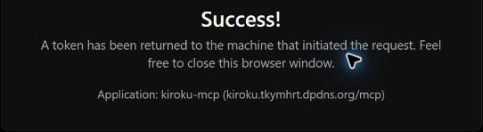

# MCP本番公開

2026-10-21 JST、本人の「本番への反映」指示により公開した。先に報告した初回CPU超過の制約は残る。Paid・追加API課金は有効にしていない。

- 画面：[きろく](https://kiroku.tkymhrt.dpdns.org/)
- MCP：`https://kiroku.tkymhrt.dpdns.org/mcp`（OAuth / DCR）
- Worker：既存`kiroku`、Version `1c1a39a7-cbed-4f35-a142-89b8d981ba49`がlive
- D1：既存`kiroku-db`。migration `20261020145658_abnormal_northstar.sql`をVoidが適用し、全3件applied
- 専用Access：`kiroku-mcp`、application ID `c28b8ff3-073a-4df4-888e-8eb846699eec`。本人1件Allow＋既存Cloudflare IdP Require。既存Worker全体のAccessポリシーは変更なし

OAuthのDCR redirectはChatGPTの現行・従来コールバックだけを許可し、localhost・loopbackの任意redirectは無効にした。変更後もAllow/Include/Require/Excludeと168時間のsessionを個別に照合した。

## バックアップと適用

公開前に公式D1 exportを取得し、メモリ上のSQLiteで整合性検査とライブD1の全表digest一致を確認した。SQLは95,147bytes。ディスク暗号化状態の読取権限がなかったため、SQLを平文ファイルへ書かずWindows DPAPI CurrentUserで暗号化した。復号後も元SQLとのバイト一致を検証した。

保存先は`C:/Users/TkymHrt/AppData/Local/Kiroku/Backups/diary-20261021-before-mcp.sql.dpapi`、隣の`diary-20261021-before-mcp.sql.manifest.json`に照合結果を保存した。Git・共有フォルダーには置いていない。暗号ファイルはBase64表現のDPAPI保護bytesで、復号は同じWindowsユーザーの`ProtectedData.Unprotect(..., CurrentUser)`を使う。端末/ユーザープロファイル喪失をまたぐ可搬バックアップではない。復元対象は新しい空DBとし、既存の[復旧手順](operations.md)に従う。

MCP_ORIGIN・MCP_ACCESS_AUD・MCP_CURSOR_SECRETはVoidのsecret stdin入力で登録し、名前6件を再照会した。署名鍵は専用の乱数で、既存認証secretは維持した。Access保護されたreadinessへ短期本人JWTを当該deployプロセスだけで渡し、Voidの通常staged deployでbuild、migration、readiness、activation、routes更新が成功した。

`void.config.ts`には既存の独自ドメインrouteを明示し、Voidがlockを更新した。Worker・DBのidentity、workers.dev維持、preview無効、観測ログ無効を維持した。別のデプロイ設定は追加していない。

## 公開後の確認

[本文・認証情報を含まない確認結果](mcp-production-proof.json)に28項目を記録した。

- 独自ドメインと旧workers.devの8経路ずつが匿名ではAccessへ302。
- 独自ドメイン`/mcp`は匿名401、OAuth resource metadataと認可サーバーmetadataは200。
- 本人JWTでHTML・session・一覧・JSON出力は200。8つのセキュリティヘッダーを確認し、旧workers.devのsessionも200。
- ブラウザAPIのCSRFなしPOSTは403。MCPの不正Origin、Sec-Fetch-Site付き要求、別originの入口は403、queryは400、GETは405。
- 本番専用audienceの本人JWTと公式SDKでinitialize・tools/list・ping成功。5ツール、うち読取4つを検出。
- 元のAccessポリシーは公開前と一致。日記・本文操作receipt・app_metaの全行digestも公開前バックアップと一致し、DB epochを変更していない。

この公開作業時点では実日記への要約・本文書込、ChatGPTへの実本文送信、実データを使うE2Eは実行していない。要約保存・無人スケジュールの書込は[一時環境の架空データ試験](mcp-verification.md)の証跡を使った。後続の本人承認による[ChatGPT本番接続・日次タスク登録](mcp-chatgpt-production.md)は別記録とし、停止済みの検証用タスクは再開していない。

## 運用上の制約

前回の実測は通常4〜6ms、初回最大20msで、Workers Freeの10ms安定条件は未合格。公開はこの制約を報告した後の本人指示によるもので、課金で解決していない。認証・日次上限エラーで本文や下書きを消さず、必要なら停止・再認証・次回回収を行う。OAuth grantは168時間、access tokenは15分。

今回の公開前確認は型・Lint・整形と本番build。機能コードは前回の`check`（単体110件・Workers6件）成功時から変更していない。追加変更は既存routeの明示と公開記録。全文負荷・DB復元を本番で繰り返していない。
