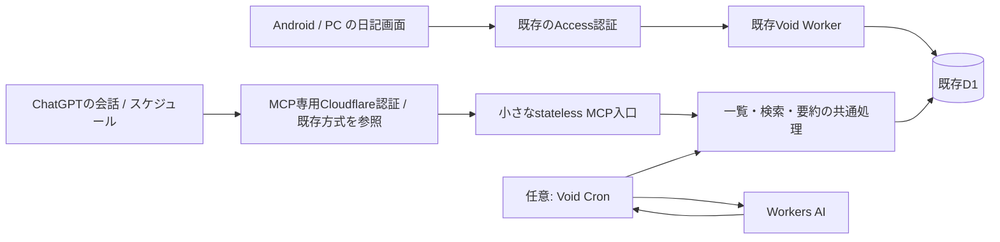

# 日記MCP・日次要約の実現性調査と提案

調査日: 2026-10-20（Asia/Tokyo）。実装採用前の提案であり、現行MVPの確定要件を変更するものではない。

利用条件（利用者確認済み）: ChatGPTの有料プランを既に契約しており、追加費用なしを優先する。まず既契約のChatGPT利用枠での実現を検証し、通常の従量課金APIを初期案には含めない。

既存環境での実証（利用者申告）: 「Slack Dumper」プラグインから、Cloudflareで認証するホスト済みMCPへの接続と、定期タスクによる取得に成功している。接続先は`https://mcp-slack.nutfes.net/mcp`。ホスティングは別アカウント。MCP接続と定期読取そのものの可否は、この既存運用を実証として扱う。

## 結論

**個人用の小さなMCPサーバーは、既存のWorkers/D1無料枠で運用できる見込みが高い。** 日記の一覧・検索・取得と、本文と分離した要約保存を提供する。AIの推論費用とサーバー費用は別に評価する。

利用者の費用方針と既存運用の実証に合わせ、採用する基本方針は**ChatGPTのスケジュールタスク → Cloudflare認証付きMCP → 既存D1**とする。実行場所と接続方法は成功しているSlack Dumperの設定を参照し、既契約のChatGPT利用枠で追加のAI API料金を避ける。今回新しく確認する中心は、要約の書込が定期実行で承認待ちにならないことと、日記の更新・削除・復旧時にも正しく保存できること。認証の具体方式・更新設定は既存構成を確認して踏襲する。[Scheduled tasks](https://learn.chatgpt.com/docs/automations)、[カスタムMCP接続](https://developers.openai.com/api/docs/guides/custom-mcp-server)

**Void Cron → Workers AI → 同じ要約保存処理**は、ChatGPTからの要約書込が実際に運用上の問題になった場合の代替とする。現時点で追加実装する必要はない。チャットでの対話検索にはMCPを使い続ける。

今回実施したのは公式資料・公開実装の調査、現行コード確認、およびローカルMiniflare D1での10項目の実験。実MCPの接続・デプロイ・実AI推論・ChatGPTへの登録・タスク作成は実施していない。

## 1. アイデアを三つの機能に分ける

| 機能                   | 具体例                                                       | 担当                                             |
| ---------------------- | ------------------------------------------------------------ | ------------------------------------------------ |
| 日記の参照             | 「昨日の日記を見せて」「先月に書いた日は？」                 | MCPがD1から取得する                              |
| 日記を横断した振り返り | 「最近どんな勉強をしていた？」「旅行の準備をした日を探して」 | MCPで候補検索・原文取得し、会話側のAIが回答する  |
| 日次要約の保存         | 前日の日記を200〜400字程度へ要約し、後から更新する           | AIが生成、サーバーが元本文の版を確認して保存する |

MCPはデータと操作の窓口であり、MCPを立てただけでAI要約や時刻実行が動くわけではない。生成主体と起動主体を別に選ぶ設計にすると、ChatGPTとWorkers AIの切替が容易になる。

## 2. ChatGPTで実現できる範囲

- 現行の公式手順は、ChatGPT WebのPluginsから「Add custom MCP server」で追加し、個人用プラグインとしてインストールするもの。読み取り・書き込み、SSE・streaming HTTP、OAuthに対応する。個人利用でディレクトリへの一般公開を先に行う必要はない。[カスタムMCP接続](https://developers.openai.com/api/docs/guides/custom-mcp-server)
- Webのスケジュールタスクは、そのチャットで利用できる接続済みツール・プラグイン・スキルを使える。ローカルフォルダーを必要としない構成なら、PC常時起動を避ける候補になる。ローカル実行タスクはPCとアプリの起動が必要。[Scheduled tasks](https://learn.chatgpt.com/docs/automations)、[公式チュートリアル](https://developers.openai.com/training/walkthroughs/scheduled-tasks)
- カスタムMCPの書込は標準では確認対象。同一会話で判断を記憶できる説明はあるが、新しい会話や再読み込みで再確認が発生し得る。定期実行ごとに承認を要求されないことは実機で検証する。書込を`readOnlyHint: true`に偽装しない。[書込確認の仕様](https://developers.openai.com/api/docs/guides/custom-mcp-server)
- 契約プラン・利用枠・段階的提供・ワークスペース設定の影響を受ける。毎日1回でも成功保証や無制限利用にはならない。通常のAPIキー方式の料金を、ChatGPT契約の利用枠と混同しない。[料金・利用枠](https://learn.chatgpt.com/docs/pricing)

利用者の既存環境では接続と定期読取が成功しているため、これらの一般的な可否確認を採用判断の障害にはしない。今回追加する要約書込の承認動作は別途確認する。

### Slack Dumperの確認結果

| 確認対象                          | 根拠と結果                                                                                                                                                                       |
| --------------------------------- | -------------------------------------------------------------------------------------------------------------------------------------------------------------------------------- |
| 実アカウントでのMCP接続・定期取得 | 利用者が成功を確認済み                                                                                                                                                           |
| ホスト済みMCPのCloudflare認証     | 利用者申告により確認。具体的な認証方式と管理設定は未取得                                                                                                                         |
| ローカルSlackdumpの実装           | `internal/mcp/server.go`にStreamable HTTPの`/mcp`と取得ツールを確認。`tools.go`のデータ取得ツールに読取注釈を確認                                                                |
| 公開URLの外部確認                 | 2026-10-20、MCP入口と標準のwell-knownメタデータURLへの未認証GETはいずれもHTTP 403。Cloudflareの応答はブラウザーのシグネチャによる拒否を示した。OAuthメタデータは取得できていない |

外部確認の403は、この確認経路に対するCloudflareの拒否であり、利用者のChatGPT接続失敗を示すものではない。ローカルコードと公開環境の配備版が一致することも未確認。既存認証をManaged OAuthだと推測で確定せず、別アカウントのAccessアプリ設定が参照できる場合に方式を確認する。認証情報やSlack本文の取得、設定変更は行っていない。

## 3. 推奨構成と認証



### 既存のCloudflare認証を参照して再利用

Slack Dumperで成功している方式を最初に確認し、きろくの本人限定認証に合わせて採用する。日記のデータ・認証先はきろく用に分離し、他アカウントのSlack用認証情報を流用しない。Managed OAuthは、既存方式が同機能である場合、または新しいMCP用Accessアプリに適する場合の候補とする。

既存のブラウザ用Accessをそのまま置くだけでは、非ブラウザのMCPクライアントは通常の302ログインを完了できない。CloudflareのManaged OAuthを使うと、401チャレンジ・認可コードフロー・トークン更新をAccess側へ任せられる。元のWorkerには`Cf-Access-Jwt-Assertion`が渡されるので、現在の署名・issuer・audience・期限・本人照合を活かせる。[Managed OAuth](https://developers.cloudflare.com/cloudflare-one/access-controls/applications/http-apps/managed-oauth/)

Managed OAuthには資料上Beta表記がある。同機能を採用する場合は、きろく側Freeアカウントでの有効化可否・追加料金条件を確認する。既存環境と同じ設定だと確認できる部分は再利用し、独自OAuthや別認証サービスの追加を先に決めない。

実装時は次を確認する。

- MCP専用ホスト名または専用パスのAccessアプリを用意する。同じWorkerへルーティングする案を優先し、D1や日記本文を別サービスへ複製しない。別Worker案は独立した認証設定が必要な場合の代替とする。
- ブラウザ向けの現在のAccessアプリと本人Allow policyを維持する。MCP用にも本人以外を拒否し、Worker側でもMCP用audienceを照合する。複数のaudienceを全ルートで無条件に受け入れる実装にしない。
- 現行`middleware/01.security.ts`は全書込にsame-originと`x-kiroku-csrf`を要求する。そのため既存APIを包むだけではMCPのPOSTが拒否される。MCP入口に限定して、Access/OAuth認証とMCP向けOrigin・Host検証を行う経路を設計し、ブラウザAPIのCSRF保護は維持する。
- Cloudflareのopaque OAuthトークンをWorkerでJWTとしてデコードしない。Accessが検証・変換して渡す署名済みassertionを検証する。
- OAuthの期限・失効時は停止し、再接続を案内する。資料の推奨例では短いaccess tokenと1〜2週のgrant sessionを組み合わせるため、永久に再認証不要とは考えない。

既存方式の再利用やManaged OAuthが適さない場合は、公式のCloudflare OAuth実装例を基に認証アダプターを追加する案がある。本人限定、PKCE、discovery、audience、refresh/revokeなどが増えるため追加の代替案とする。ChatGPTは独自APIキーや任意のAccess service tokenヘッダーを前提に接続できるとは限らず、URLへ秘密を埋める設計は採らない。[OpenAIのMCP認証契約](https://developers.openai.com/plugins/build/auth)、[Cloudflareの認証構成例](https://developers.cloudflare.com/cloudflare-one/access-controls/ai-controls/secure-mcp-servers/)

### MCPの実装方式

Streamable HTTPを使う小さなstatelessサーバーを第一候補とする。Cloudflareの現行資料では`agents/mcp/server`の`createMcpHandler`とMCP SDK v2の組み合わせが案内されている。古い記事の`McpAgent`は現在deprecatedなので、そのままコピーしない。具体的な依存バージョンは実装時にSDK同士の互換性を確認する。[MCP handler APIs](https://developers.cloudflare.com/agents/model-context-protocol/apis/handler-api/)

Voidの`defineHandler`からRequest/Responseを接続するアダプターを検証する。現在の設定・既存リソース識別情報を保ち、生成物を直接編集せず、公開・migrationはVoid CLIで管理する。常設サーバー、Docker、常時起動PC、会話状態用Durable Objectを初期構成の必須条件にしない。

## 4. 最初に公開するツール

| ツール案                 | 用途・返却内容                                               | 権限     |
| ------------------------ | ------------------------------------------------------------ | -------- |
| `list_diaries`           | 日付範囲・cursorで一覧。日付、ID、版、要約の有無・鮮度を返す | 読取     |
| `get_diary`              | 指定日の原文とID・version・epoch。長文は版を固定して分割取得 | 読取     |
| `search_diaries`         | 検索語・日付範囲から日付、ID、短い該当箇所、次cursorを返す   | 読取     |
| `list_pending_summaries` | 要約なし、本文追記後、生成失敗の日を件数制限付きで列挙       | 読取     |
| `save_summary`           | 読み取った本文のID・version・epochと要約を受け、条件付き保存 | 要約書込 |

原文取得に最新要約とその生成元の版も含めれば、初期に独立した要約取得ツールは不要。必要なら後でChatGPTの標準`search`/`fetch`形へアダプターを足す。これらの形はCompany knowledge等との互換に使われるもので、カスタムMCP接続の全用途に一律必須ではない。[OpenAI MCP実装ガイド](https://developers.openai.com/plugins/build/mcp-server)

SQLを直接実行するツール、全日記一括取得、原文の自動上書き・削除・完全削除は初期に含めない。検索→必要な日だけ原文取得→日付を添えて回答する流れにする。検索結果だけで「全期間に存在しない」と断定せず、検索対象期間・件数制限・続きを明示できるようにする。

本文は最大1MBを許すため、取得時のバイト数上限・次cursor・完了フラグを持たせる。要約は原文の全分割を同じ版で読み終えた場合だけ保存する。上限を超えて処理できない日は、途中の本文を全文とみなさず未処理として残す。

## 5. 本文を守る要約データの持ち方

要約は`diaries.body`へ追記せず、別テーブルに置く。要約保存で`diaries.version`を進めるとブラウザの同期と不要に競合するため、要約自身にrevisionを持たせる。

保存項目の候補:

- `diary_id`、`source_version`、`source_epoch`、必要なら本文のhash。
- `summary_markdown`、`prompt_version`、生成方式、確認できたモデル識別子、`generated_at`。
- 要約の`revision`、上書き前の要約履歴、固定した操作IDとリクエストhash。

ChatGPT側から実際のモデル識別子が得られなければ、推測で保存せず不明として扱う。要約はまず短い文章と箇条書き程度に絞り、タグや人物一覧は検索で必要になってから加える。

保存条件は、同じdiary IDが有効であること、本文versionとDB epochが一致すること、期待する要約revisionが一致すること。これらをprimary優先の同一書込条件で確認する。本文更新中・ゴミ箱化・完全削除・同日再作成・DB復旧が起きたら古い生成結果を拒否し、新しい原文を読み直す。

再送は操作IDとpayloadを固定する。同ID・同payloadなら前の結果を返し、異payloadなら拒否する。既存の本文用`mutation_receipts`の契約を変更せず、要約操作に適したreceiptを別途設計し、要約変更とreceiptを同一batchに入れる。今回の実験は書込条件の原型だけであり、要約receipt・履歴・競合全体を実装したものではない。

原文の更新後は以前の要約を「古い」と判定できるようにする。ゴミ箱は通常検索と要約対象から除外し、完全削除では要約履歴と検索索引も削除する。バックアップ・JSON出力へ要約を含める範囲、復元時の索引再構築、epoch回転後の扱いを実装時に更新する。

AIに渡す日記はすべてデータとして扱い、本文中の命令や外部URLへ従って別ツールを動かさない。日次タスクのツールは日記取得と要約保存へ限定する。本文・検索語・トークンをURLやログに含めず、AIには必要な範囲だけ渡す。個人用ChatGPTへ送信するデータの扱いも本人の利用設定と合わせて確認する。

## 6. 毎日深夜の処理

初期案は**毎日00:15 JSTに、前日の日本時間の日記を処理**する。たとえば10月21日00:15なら10月20日を対象とする。「今日」という曖昧な文字列をAIに判断させず、サーバーが対象日とタイムゾーンを返す。

1. 前日までの未要約・古い要約を少数件取得する。通常は1件、失敗や遅い同期があれば後日回収する。
2. D1保存済みの原文とID/version/epochを取得する。IndexedDBだけの下書きは読めない。
3. 事実を追加せず、重要な出来事と本人の振り返りを日本語で要約する。未記載の感情・行動を補わない。
4. 固定した操作として条件付き保存する。本文が変わっていれば結果を捨てて再取得する。
5. 失敗・期限切れ・未処理を次回回収する。無制限の再試行や同じ日の再生成を避ける。

日付をまたいで前日の画面を編集しても、アプリの編集対象日は動かさない。要約後に追記や遅い同期があれば、その版だけ再要約対象へ戻す。更新直後の再生成を避ける短い待ち時間を設けてもよい。

ChatGPTのタスクを使う場合、最初は同一チャットの定期実行で検証し、新規会話ごとの承認状態への依存を確認する。Cron案ではVoidの`crons/`と`defineScheduled`を使う。Cloudflareの時刻はUTCなので、00:15 JSTは`15 15 * * *`に相当する。起動時刻の遅延・欠落を前提に、未処理一覧から回収する。[Cron Triggers](https://developers.cloudflare.com/workers/configuration/cron-triggers/)

## 7. 無料枠の試算

金額・上限は2026-10-20の公開資料。アカウント全体で共有される枠は既存アプリ等の利用分も差し引く。

| 項目        | Freeの主な上限                                  | この用途での判断                                                               |
| ----------- | ----------------------------------------------- | ------------------------------------------------------------------------------ |
| Workers     | 100,000リクエスト/日、CPU 10ms/呼出             | 回数は余裕がある見込み。OAuth/JWT・SDK初期化・長文処理のCPU実測が必要          |
| D1          | 読取500万行/日、書込10万行/日、総容量5GB        | 少数件の読取・要約保存は小さい。全文走査・索引更新の増分を測る                 |
| D1単一DB    | 500MB、Freeで最大10DB、Time Travel 7日          | 総容量5GBと1DBの上限を混同しない                                               |
| Cron        | Freeはアカウント当たり5個のtrigger、CPU制限あり | 毎日1本で開始できる。外部AIの待機時間とCPU時間を区別する                       |
| Workers AI  | 10,000 Neurons/日                               | 少量の日次要約は枠内の見込み。モデル別の対象・出力・推論量を確認する           |
| ChatGPT利用 | 契約プランの利用枠                              | 既契約で対応機能が使えれば追加費用なしの候補。Freeで同じ機能が使えるとは未確認 |

根拠: [Workers料金](https://developers.cloudflare.com/workers/platform/pricing/)、[Workers制限](https://developers.cloudflare.com/workers/platform/limits/)、[D1料金](https://developers.cloudflare.com/d1/platform/pricing/)、[D1制限](https://developers.cloudflare.com/d1/platform/limits/)、[Workers AI料金](https://developers.cloudflare.com/workers-ai/platform/pricing/)、[ChatGPT料金・利用枠](https://learn.chatgpt.com/docs/pricing)。認証は既存の成功構成を参照し、きろく側で同等の機能を追加費用なしで使えることを確認する。Managed OAuthを採用する場合は同機能の提供条件も確認する。

概算例:

- 本文平均20KB/日を10年で約73MB、要約平均2KB/日で約7.3MB。ここに索引・receipt・履歴・SQLiteの管理領域が加わる。trigramの容量を実データ相当の架空コーパスで測る。毎日1MB近い本文では、索引なしでも約500日分で単一DB上限に近づく。
- 3,650日分を100回/日、単純に全行走査するなら約365,000行/日が目安。実際の課金行数は索引やquery planで変わるので、D1の`meta.rows_read`/`rows_written`で測定する。
- Workers AIの例として`@cf/qwen/qwen3-30b-a3b-fp8`の掲載単価は入力100万token当たり4,625 Neurons、出力100万token当たり30,475 Neurons。**入力5,000・出力800tokenなら約47.5 Neurons/回**という算術見積もりになる。日本語の文字数からtoken数を固定換算せず、推論出力・再試行を含む実測で判断する。品質・速度・モデルへの実アクセスは未検証。[モデル別料金](https://developers.cloudflare.com/workers-ai/platform/pricing/)

Free上限に達した場合は未処理を残して停止する構成にする。無料運用の判定には、ホスティングの回数だけでなくCPU 10ms、単一DB容量、AIの出力量、認証機能の提供条件まで含める。

### 1年の運用見込みと長期の課題

**本文が毎日数KB〜20KB程度、画像添付なし、検索は部分一致、要約は日次という想定なら、今後1年の無料枠運用は十分現実的。現段階で容量を理由に自宅サーバー/VPSへ移す必要性は低い。** ただしMCPのCPU使用量は導入時に実測する。無料枠が将来も同じ条件で提供されることや、実行が毎日必ず成功することまで保証する判断ではない。

容量の根拠として、既存migrationを使ったローカルSQLiteのメモリ内DBに365日分の架空データと操作履歴を作成した。本文20,000 UTF-8バイト/日、要約2,000バイト/日を1版ずつ保存する条件で、主キー・日付索引・操作履歴を含むページ割当量は次のとおりだった。

| 本文の保存成功回数/日 | 1年の本文操作履歴 | 1年分のDB全体 | うち操作履歴とその索引の増分 |
| --------------------- | ----------------- | ------------- | ---------------------------- |
| 100回                 | 36,500件          | 約20MB        | 約11MB                       |
| 500回                 | 182,500件         | 約66MB        | 約57MB                       |
| 1,000回               | 365,000件         | 約123MB       | 約114MB                      |

これはアプリに入力した回数や打鍵数ではなく、D1への本文保存が成功した回数。現行の自動保存は約1秒のdebounceで、実際の保存頻度は書き方次第で変わる。再送が同じ操作として認識される場合は履歴を重複追加しない。

実行は`mise exec -- python scripts/mcp-capacity.py`、証跡はGit対象外の`test-results/mcp-capacity.json`。この試算は実D1の容量計測ではなくSQLiteでの近似であり、既存DBの現在容量・FTS・要約の複数版・要約用receipt・クラウド側の管理領域は別途加算する。要約を日次で1回保存する程度の追加履歴は本文の高頻度保存に比べて小さいが、無制限の再生成は避ける。本文だけでも毎日1MBなら1年で365MBになるため、その使い方は別判定とする。

課題は時期を分けて扱う。

| 項目                                | いつ問題になりやすいか                                 | 対応案                                                                                              |
| ----------------------------------- | ------------------------------------------------------ | --------------------------------------------------------------------------------------------------- |
| Workers CPU 10ms/呼出               | SDK初期化・JWT照合・大きなJSON処理が重いと導入直後から | MCPを小さく実装し、返却量を制限。実クラウドで認証込みCPUを測る                                      |
| 永久保持する本文操作履歴            | 保存頻度に比例して数年単位で増加                       | 容量と成功保存件数を確認する。容量目的でreceiptを期限削除しない                                     |
| 検索索引の容量と書込増幅            | FTS導入時や長文の高頻度更新時                          | 最初は部分一致。FTSは必要になった時点で容量と`rows_written`を測る                                   |
| AIによる大量反復検索・再生成        | 呼出しのループや失敗時の連続再試行                     | 件数・本文量・再試行回数を制限し、要約済みの同じ版はスキップする                                    |
| 認証・ChatGPT・Cloudflareの仕様変更 | データ量と無関係に起こり得る                           | 失敗を検知し、再接続と未処理回収を用意。既存の成功構成を参照する                                    |
| 過去の誤削除・破損からの復旧        | 7日を超えて気づいた場合                                | Time TravelのFree保持は7日。現行の破壊的変更前退避に加え、定期SQL退避を運用上の追加案として検討する |

Workers/D1の1日当たりの枠は累積して1年で尽きるものではない。本文1,000保存/日でもHTTP呼出し数は通常の付随通信を含めて10万回/日より十分少ない見込み。D1書込数は本文・receipt・索引更新により保存回数より増えるので別計測する。1年分365日を100回/日全行検索した場合の本文走査は単純計算で約36,500行/日で、読取500万行/日より小さい。いずれも同一アカウントの他アプリの利用分を差し引く。[Workers制限](https://developers.cloudflare.com/workers/platform/limits/)、[D1料金・上限超過時の挙動](https://developers.cloudflare.com/d1/platform/pricing/)、[D1容量・Time Travel制限](https://developers.cloudflare.com/d1/platform/limits/)

運用判断の提案として、1DBが250MBに達した時点、または直近の増加速度から半年以内に500MBへ達しそうな時点で移行を検討する。CPU超過や日次枠の超過が通常利用で繰り返される場合は、容量を待たず設計を見直す。これらはCloudflareの公式閾値ではなく、移行の時間を確保するための目安。

### アプリ全体のセルフホストを選ぶ場合

VoidにはNode.js/Bun向けの出力先があるため、React画面・ファイルAPIルーティングを活かした移行を検討できる。DBスキーマと主要SQLはSQLiteなので、DBをローカルSQLiteへ移す方向が自然。ただし現行コードは`cloudflare:workers`のD1 binding、`withSession('first-primary')`、D1のbatch、`void/env`を使っており、設定変更だけで移行完了にはならない。DB接続・transaction・環境変数とMCP認証のアダプターを実装し、receiptの原子性と復旧時のepoch回転を再検証する必要がある。

自宅サーバー/VPSではストレージとCPUを自分で確保できる一方、稼働監視・更新・バックアップ・障害復旧・外部から届くHTTPS/OAuth入口の管理が必要になる。ChatGPT側の書込承認や利用枠は、サーバーを移しても残る。いま移行基盤を先行実装せず、MCPは内部の共通処理を呼ぶ薄い入口とし、既存のSQL退避・復元経路を保つ方針を勧める。

参照した同梱仕様: `node_modules/void/docs/integrations/nodejs-bun-deno.md`。セルフホスト先の構築、設定変更、デプロイは今回行っていない。

## 8. 日本語検索

初期版は日付絞り込みとパラメーター化した部分一致を採用するのが小さい。数年分の日記なら、まず実データ相当のサイズで応答時間と読取行数を測る。`instr`なら`%`や`_`を利用者の文字として扱える。英字大小・全半角・Unicode正規化は検索仕様として別途決め、Markdown原文自体は書き換えない。

FTSを足すならtrigramを候補とする。ただし3文字未満のMATCHはヒットしないので、短い日本語語句には部分一致へのフォールバックが必要。標準の`unicode61`だけで日本語検索を完成としない。D1はFTS5を提供しているが、実クラウドD1でのtokenizer・移行・バックアップ復元も別に確認する。[D1のSQLite拡張](https://developers.cloudflare.com/d1/sql-api/sql-statements/)、[SQLite trigram仕様](https://sqlite.org/fts5.html#the_trigram_tokenizer)

「関連する内容」の最初の段階は、会話AIによる語句の言い換え・日付での絞り込み・複数検索・原文確認で対応する。意味だけが近い記録も必ず見つける機能ではない。これで不足が見えた段階で、日本語embeddingとベクトル検索を追加する。Vectorize・別DB・RAG基盤を最初から必須にしない。

## 9. 先行例と取り入れる点

| 先行例                                                                                                      | 確認できたもの                                      | きろくへの示唆                                                       |
| ----------------------------------------------------------------------------------------------------------- | --------------------------------------------------- | -------------------------------------------------------------------- |
| [dayone-mcp](https://github.com/benlen10/dayone-mcp)                                                        | 日記の読取専用MCP。本文・日付などの絞り込み         | 個人日記をMCPで振り返る用途は既存。まず読取範囲を小さくする          |
| [dayone-headless](https://github.com/yunanwg/dayone-headless)                                               | 一覧・取得・検索、返却サイズ制限、CJKの部分一致経路 | 日本語の短語問題と文脈量の抑制を設計へ反映できる                     |
| [mcp-obsidian](https://github.com/MarkusPfundstein/mcp-obsidian)                                            | Markdownノートの検索・取得・追記・編集・日次ノート  | 道具の分割を参考にしつつ、原文全置換等の広い権限は初期には持たせない |
| [Cloudflare MCP handler](https://developers.cloudflare.com/agents/model-context-protocol/apis/handler-api/) | WorkersでstatelessなMCPを提供する現行API            | 常時起動の専用サーバーを追加せずに構築する候補                       |

これらの公開実装は機能・設計の参考として確認したもので、コード全体の安全性監査や導入試験を行ったものではない。今回確認した資料から、**ChatGPT定期実行＋Access Managed OAuth＋きろくD1への要約保存まで一式で実証済みの事例**は確認できていない。個別機能の対応と接続全体の実証は分ける。

## 10. 今回のローカル検証

再実行:

```powershell
mise exec -- node scripts/mcp-feasibility.mjs
```

既存migrationを一時的なMiniflare D1へ適用し、2080年の架空データだけで実験する。既存ローカルDB・本番DBへ接続しない。結果はGit対象外の`test-results/mcp-feasibility.json`へ出力する。

実行環境: Node v24.21.0 / Miniflare 4.20260730.0 / compatibility date 2026-02-24。**10/10項目成功**。

| 検証                                             | 結果                                           |
| ------------------------------------------------ | ---------------------------------------------- |
| 「今日は図書館で読書した。」から「図書館」を検索 | unicode61は0件、trigramは該当                  |
| 「東京」を検索                                   | trigram MATCHは0件、部分一致なら該当           |
| 英字語とゴミ箱除外                               | 英字語に該当し、有効日記とのJOINでゴミ箱を除外 |
| 別表への要約保存                                 | 本文のversionが変わらない                      |
| 古い要約revisionで上書き                         | 拒否。最新revisionなら更新                     |
| 本文追記後に旧versionの要約を保存                | 拒否。最新versionなら保存                      |
| DB epoch変更後に旧結果を保存                     | 拒否                                           |
| ゴミ箱の日に要約を保存                           | 拒否                                           |
| 完全削除・同日再作成後に旧IDの結果を保存         | 拒否                                           |
| 00:15 JSTの対象日、年境界                        | 前日のTokyo日付を算出                          |

検証範囲は検索方式とSQL条件の原型だけ。MCPプロトコル、HTTP middleware接続、認証、同時実行、要約receipt、削除連動、実AI品質、クラウドCPU、実アカウントの定期実行はこの試験では証明していない。

## 11. 採用までの順序

1. **読取MCPをローカル実装**: 一覧・取得・検索、件数とバイト数の制限、ゴミ箱除外、認証拒否を確認する。MCP Inspectorでinitialize・tools/list・tools/callを試す。
2. **既存認証の参照と日記MCPへの接続**: Slack DumperのCloudflare認証とChatGPT側の接続方法を参照する。方式を決めてから、きろく用MCPと本人限定認証を架空データで確認する。Managed OAuthを採用する場合はFree提供条件を確認する。既存本番Access設定を先に変更せず、冷起動・JWT照合込みCPUを測る。
3. **手動要約の条件付き保存**: 別表・receipt・履歴を実装。実行中の本文更新、消失した応答の再送、ゴミ箱・完全削除、epoch変更、長文分割中の更新を検証する。DB変更はVoidでmigration生成・レビューし、バックアップ復元試験も拡張する。
4. **既存の定期実行設定を踏襲して保存を試す**: 読取の定期実行は既存運用で成功しているため、今回の試行は読取→要約→無人保存、同じ日の再送、失敗翌日の回収、原文更新後の再要約に集中する。認証更新・失効の設定も既存構成を参照する。
5. **問題が生じた場合だけCronを検討する**: 要約の書込承認や利用枠が運用の妨げになる場合にWorkers AIへ移す。架空の日本語日記で品質・長文・事実追加・費用を比較し、日次処理だけ置き換える。

実装の初期範囲として勧めるのは、**一覧・検索・原文取得・要約保存・未処理回収**。原文の自動編集、人物グラフ、高度な意味検索、週次・月次要約は、実際の利用価値が確認できてから追加する。
